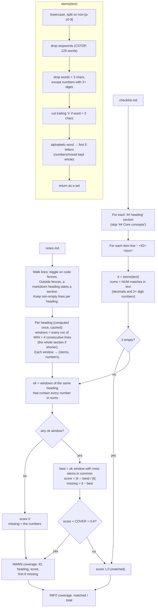

# Coverage check (checklist items vs notes), v2

`chapter_tools.py check` runs this when the notes carry no checklist IDs. Code: `stems()`, `coverage()` and the constants `COVER`, `WIN`, `NUM`, `CSTOP` in `scripts/chapter_tools.py`.

Question it answers: for each checklist item, is there one small passage of the notes, under the same heading, that holds most of its content words and all of its multi-digit numbers? Items without such a passage get a WARN, and the LLM fixes only those. A false WARN costs a little LLM attention. A miss means a fact silently dropped from the notes.

## Flow

## Worked examples (DDIA ch04)

**1. Number rule.** Item `A-H1.1.3-08` under `### Bloom filters`:

> Rule of thumb: 10 bits per key gives ~1% false positives; every 5 additional bits per key cuts the probability tenfold.

- Stems (12): `10 addit bit cut false give key posit proba rule tenfo thumb`. Numbers: `10` (`1` and `5` are single digits, so they are ignored).
- Intact notes: the window holding "Rule of thumb: **10 bits per key**..." contains `10` and all 12 stems, so the score is 100%.
- Delete that line: no other window under "Bloom filters" contains `10`, so the score is 0 and the WARN shows `missing ['10']`. The same happens if the line stays but says "some bits per key".

**2. Window instead of whole section.** Item `A-H1-10` under `# Storage and Indexing for OLTP`:

> `db_set` performs well because appending to a file is generally very efficient.

- Stems (7): `appen effic file gener perfo set well`.
- Delete the note line "`db_set` performs well for something so simple, because appending to a file is generally very efficient."
  - v1 (whole section): 100%, so it was missed. Every stem still appears somewhere in this long section.
  - v2 (best 4-line window): 4/7 = 57%, missing `effic set well`, so it is flagged.

## Calibration (DDIA ch04, 337 items)

Simulated drop = delete the one note line that best matches the item, then check whether that item is flagged.

| Test | v1 (section) | v2 (window + numbers) |
| --- | --- | --- |
| Intact notes, false WARNs | 0 (min score 0.62) | 0 (min score 0.62) |
| Best-matching line deleted, flagged | 122/337 (36%) | 219/337 (65%) |
| Bullet with its sub-bullets deleted, flagged | 287/400 (72%) | 366/400 (92%) |
| Multi-digit number removed from its line, flagged | 0/20 | 19/20 |

- The best-line rows and the number row were measured by both the reviewer and the author. The bullet row is the reviewer's figure only.
- Threshold sensitivity is higher in v2. False WARNs at 0.65 / 0.7: v1 1 / 2, v2 3 / 6. Keep 0.6 unless a chapter calibrates otherwise.
- "Deleted best line" overstates real losses: several hand-checked misses were only partial losses. So true recall is somewhat better than the table shows.

## What has changed from the first version

| | v1 | v2 | Why |
| --- | --- | --- | --- |
| Matched against | all notes text under the item's heading | best window of `WIN = 4` consecutive non-empty lines under that heading | In a long section, common words (key, page, index) covered an item from other lines, so v1 caught only 36% of single-line drops. |
| Numbers | treated as ordinary words that could match anywhere in the section | every decimal / 2+ digit number in the item must be in the chosen window; if no window has them, score 0 and the WARN lists the numbers | v1 flagged 0/20 dropped numbers. |
| Code fences | `# comment` inside a fenced block was read as a heading | fences toggle; headings inside them are ignored (their lines still count as text) | Prevented false WARNs on bullets after a fenced block. |
| Item with no stems (e.g. only `` `ls -l` ``) | 0/0 counted as 0, so always WARN with an empty missing list | score 1.0 | Removed a permanent false WARN. |
| Caching | section stems recomputed for every item | window stems computed once per heading | Speed; the v1 doc wrongly said "cached". |
| WARN text | "% of its words in the notes" | "% of its words in the best 4-line window" | Says what was measured. |
| Doc | claimed 7/7 recall from a hand-picked sample; said "~110 stopwords" | broad calibration above; 129 stopwords | The 7/7 sample was not representative. |

Unchanged: `stems()`, `CSTOP`, `COVER = 0.6`, same-heading scope, WARN (never FAIL), and the INFO summary line.

Considered and not adopted (per the reviewer's tests): 4/6/7-letter stems, IDF weighting (no clear gain), 3- or 5-line windows and line+ancestor matching (slightly worse at 0 false WARNs), requiring single digits (7 false WARNs from enumerations like "school 2"), and a negation rule (29/54 dropped negations caught, at the cost of 3 false WARNs; left out by choice).

## Limits

- Bag of words inside the window: it checks presence, not meaning or order. A wrong statement that uses the right words passes.
- Invisible by construction:
  - negations (`not`, `never`, `cannot` are stopwords; `no` is too short): 0/54 dropped negations caught;
  - comparatives (`more`, `less`, `few`, `only`);
  - single digits (`4 KiB`, `1%`, `L0`).
- Same heading only: a fact moved under another heading is flagged only when its own heading's windows no longer match.
- Heavy paraphrase can be flagged, more so than in v1 because a window holds fewer words than a section. The fix is either to add the point to the notes or to ignore the WARN.
- The 5-letter stem can merge unrelated words (`compute`, `computer`) and split related ones (`write` vs `written`, giving `write` vs `writt`).
- Calibrated on one chapter whose notes follow the checklist wording closely. Re-check the false-WARN rate on a chapter with looser paraphrase.
